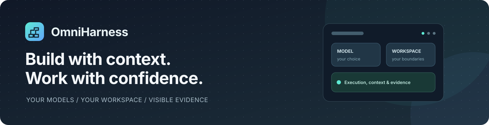
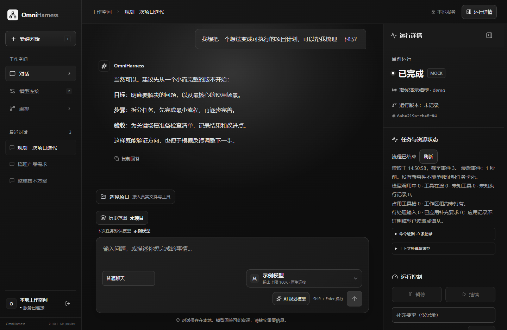
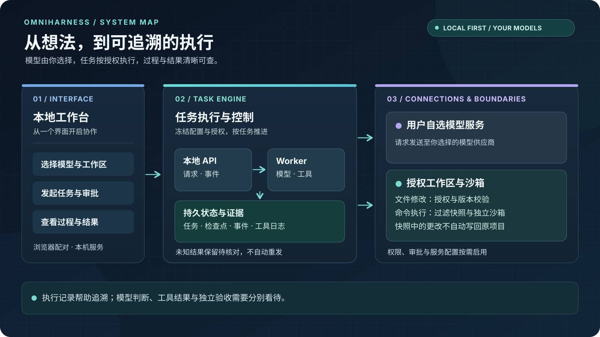

<p align="center">
  
</p>

<p align="center">
  <strong>让模型、工作区与工具协作，也让过程有迹可循。</strong><br />
  一个接入自有模型、面向本地工作流的 Agent Harness。
</p>

<p align="center">
  <a href="#为什么做这个项目">项目缘起</a> ·
  <a href="#你可以用它做什么">能力概览</a> ·
  <a href="#快速开始">快速开始</a> ·
  <a href="#当前状态与边界">当前状态</a> ·
  <a href="#致谢">致谢</a>
</p>

<p align="center">
  <strong>本地优先</strong> &nbsp; / &nbsp; <strong>自选模型</strong> &nbsp; / &nbsp; <strong>受控工具</strong> &nbsp; / &nbsp; <strong>可追溯记录</strong>
</p>

> **项目状态：开发预览。** OmniHarness 已具备本地工作台、模型连接、持久任务、受控工作区与工具等基础能力，仍在持续验证和完善；它不是已经完成全部生产场景验收的正式发行版。

## 为什么做这个项目

一个真正有用的 AI 工作助手，不仅要能回答问题，还要能理解当前任务、使用合适的工具、在明确的边界内操作文件，并在出错或中断时留下可以追查的记录。

OmniHarness 的出发点，是把这些能力放在一个用户能够理解和掌控的工作台里：模型由你选择，项目由你授权，任务如何执行、工具返回了什么，都尽可能有据可查。我们希望它既能服务一次简单对话，也能逐步支持需要多轮协作、文件修改和验证的开发任务。

它并不假设模型永远正确。我们更关心的是：**当信息不足、工具失败或结果未知时，系统能否诚实地表达状态，让人继续判断下一步。**

我们希望逐步探索由主 Agent 统筹任务，按不同环节选择合适的模型和工具，并在关键步骤引入不同 Agent 的独立复核，让规划、执行与验证形成协作。自动分派和多 Agent 交叉复核仍是正在探索的方向，尚不代表已完整实现。

在项目探索过程中，我们了解到 DeepSeek 开源的 [Super-agent 研究原型](https://github.com/deepseek-ai/dsh-superagent-prototype)，发现它在任务统筹与 Agent 协作等方面与我们的设想有相近之处。我们已参考其部分设计思路，后续也可能结合实际需求，进一步借鉴其方法或基于其开源框架开展开发。

## 工作台预览



<sub>截图来自隔离浏览器测试，使用模拟模型与示例数据；界面内容不代表真实用户任务或线上服务状态。</sub>

## 你可以用它做什么

| 能力 | 当前实现与使用边界 |
| --- | --- |
| **接入自己的模型** | 提供 OpenAI、Anthropic、Gemini 和 OpenAI-compatible 适配器；具体模型和工具调用能力以实际连接测试为准。项目不提供模型账户或 API Key。 |
| **从对话走向任务** | 在工作台中发起聊天或 Agent 任务；模型、工作区授权和上下文配置在任务开始时固定。Agent 和工具需要分别启用并通过就绪检查。 |
| **与项目文件协作** | 登记并授权工作区后，Agent 可以读取、搜索及通过带版本校验的补丁修改允许的文件；并发修改会触发冲突检查。 |
| **在沙箱中运行命令** | 命令在过滤后的项目快照中执行；沙箱内的文件更改不会自动写回原项目。工具使用需要完成独立 broker 与沙箱控制器配置。 |
| **查看执行过程** | 任务、事件、工具结果和完整日志工件会被保存；运行详情展示模型、工具、资源与审批状态。 |
| **管理上下文** | 支持按策略整理历史、摘要和工具结果；记录中的输入估算与供应商报告的缓存用量分开，缺失的信息保持未知。 |
| **引入受信任工具** | 支持受配置约束的 MCP HTTP 服务和插件；外部工具按本地配置与审批边界使用。 |

## 它是如何工作的



工作台向本地 API 提交任务，Worker 按任务固定的模型与配置推进执行。任务状态、检查点和工具结果被持久化；需要访问文件时，工具遵守工作区授权。命令在独立快照中运行，正常的原项目修改通过受控补丁完成。

当系统无法确认已派发请求的结果时，它会保留待核对状态，而不是把未知结果写成成功。**运行记录有助于追溯，不等同于保证回答正确，也不等同于自动撤销已发生的外部操作。**

## 快速开始

### 1. 准备环境

- Windows PowerShell，或 Linux / macOS shell。
- 可运行 Linux 容器的 Docker Engine 和 Docker Compose v2；首次构建需要获取项目依赖。
- 自行准备的模型服务和 API Key。模型可用性、上下文窗口及工具调用支持取决于所选供应商。

Windows 使用已准备好的专用 WSL2 Docker Engine 时，需要显式选择对应发行版；详细要求见 [安装、诊断与备份](docs/install.md)。

### 2. 启动工作台

在项目根目录运行：

**Windows PowerShell**

```powershell
.\scripts\start.ps1
.\scripts\pair.ps1
```

**Linux / macOS**

```sh
sh scripts/start.sh
sh scripts/pair.sh
```

打开启动脚本显示的本机地址（默认 `http://127.0.0.1:8787`），使用一次性配对码连接浏览器，然后在「模型连接」中配置自己的模型。不要公开配对码、API Key、数据目录或密钥目录。

### 3. 按需启用 Agent 与工具

默认配置只开启普通聊天，Agent 执行需显式启用，并通过 PostgreSQL 和检查点就绪检查。工具还需要额外完成授权、broker 和沙箱控制器配置；设置开关本身不代表这些服务已就绪。

在 Windows PowerShell 会话中启用 Agent 的示例：

```powershell
$env:OMNI_ENABLE_AGENT = 'true'
.\scripts\start.ps1
```

具体配置、模型能力探测、工具授权、审批及已知部署限制，请先阅读 [工具与上下文](docs/M4-tools-context.md) 和 [安装说明](docs/install.md)。首次启动、更新已有实例或迁移环境前，应保留数据库、主密钥和完整备份。

<details>
<summary><strong>仅用于聊天开发的 SQLite 预览</strong></summary>

准备 uv、Python 3.12 和 Node.js 24，在项目根目录运行：

```powershell
uv sync --python 3.12
cd web
npm ci
npm run build
cd ..
.\scripts\dev.ps1 start
```

SQLite 入口用于聊天开发预览，**不支持 Agent 执行**。SQLite 数据不会自动迁入 Compose PostgreSQL；请在切换部署前保留原有数据与密钥。其他操作见 [安装说明](docs/install.md)。

</details>

## 当前状态与边界

- 当前处于 **M4 开发预览阶段**。不同模型、供应商、操作系统及部署方式需要分别验证，实际行为以各自测试记录为准。
- 已有 V3 上下文策略、运行观察和有限的命令退出码提示；提示仅覆盖可以明确关联工具工件的特定情况，**不构成通用事实核查，也不能消除所有幻觉**。
- 结果未知的外部请求不能安全地一律重试；取消也不保证远端请求未发生，已经修改的文件不会自动回滚。
- 独立沙箱创建与回收服务已有源码和隔离验证，默认不自动启用；上线仍需要按实际部署环境完成存储、备份、恢复和故障验收。
- 工具沙箱基于容器，不能视为对恶意本机管理员或所有宿主风险的完整隔离。工作区、插件、MCP 服务和模型供应商都应按自身信任边界选择。
- 当前测试记录包含成功案例，也包含中等开发任务未在预算内完成、测试题口径需澄清等发现；单次任务不足以证明 V3 在成功率、缓存或成本上优于其他策略。
- 长上下文、请求恢复与原生流式审查正在验证中；最新三次真实审查仍有长响应未知和输出格式未通过项，详见[验证摘要与已知限制](docs/validation/2026-11-16-native-review.md)。
- 完整的研究工作流、自动修订闭环和跨项目长期记忆仍需后续建设；项目不提供模型中转或保证供应商可用。

## 开发与验证

```powershell
uv run python -m pytest -q
uv run ruff check src tests scripts
uv run python scripts/runtime_probe.py
cd web
npm test
npm run build
```

PostgreSQL 集成测试需要显式设置专用的 `OMNI_TEST_POSTGRES_URL`，并使用测试数据库 `omniharness_test`。测试被跳过并不代表通过；Mock、离线测试、真实沙箱与真实模型测试分别证明不同范围。真实模型请求可能产生供应商费用。

## 接下来的方向

- **让执行更可靠：** 继续完善沙箱创建、回收和故障恢复，并在正式启用前验证备份与恢复链。
- **让过程更容易核对：** 让命令、日志与证据之间的关联更清楚，始终区分模型结论与工具记录。
- **让上下文有据可评估：** 使用独立验收、明确预算及可复现任务，验证长上下文处理与不同策略的实际效果。
- **让上手与贡献更顺畅：** 改善文档、安装体验和跨环境验证，逐步建立可复现的构建与发布流程。

这些是项目方向，不代表上述能力已经全部完成。

## 文档导航

- [安装、运行与备份](docs/install.md)
- [M4 工具、授权与上下文](docs/M4-tools-context.md)
- [M4 实施记录与验证范围](docs/M4-implementation.md)
- [单模型与多模型对比方法](docs/M4-evaluation.md)
- [插件开发与示例](docs/plugins.md)
- [固定评测任务集](examples/evaluation/README.md)
- [独立沙箱创建与回收服务](docs/sandbox-creation-service.md)
- [长上下文、原生流式与请求恢复验证](docs/validation/2026-11-16-native-review.md)

## 致谢

感谢 **腾讯云 AI 校园大使计划**，让我有机会使用 **WorkBuddy**，并在项目探索中尝试十余种不同的模型。这份支持让我能够不断比较、验证和打磨想法。

也感谢每一位给我提供思路、提出建议、参与讨论和给予支持的朋友。许多看似细小的提醒，都让这个项目离真正好用更近了一步。谢谢你们一路同行。

---

本项目使用 [MIT License](LICENSE)。模型服务由用户自行选择和配置；使用外部模型或服务时，相关数据会发送至所选服务提供方。
