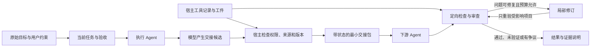

# OmniHarness Agent 交接与幻觉控制方案

日期：2026-11-10  
状态：**讨论稿，尚未确认实施，也未运行本方案的测试或部署。**

## 1. 目标和问题边界

让多个模型在思考、规划、执行和审查之间传递信息时，明确区分原始要求、实际证据与模型推断，减少错误被下游 Agent 当成事实继续传播。方案同时约束新增调用、等待时间和费用：简单任务不强制增加 Agent 或模型调用，复杂任务针对关键结论核查。

这里的“控制幻觉”是**识别、限制传播和如实呈现不确定性**，不是保证模型不犯错。格式合法、引用存在、文件哈希一致和多个模型意见一致，都不单独等于事实正确。

### 当前源码现状与版本边界

- 当前阶段图中的计划、分配结果有结构、步骤覆盖和依赖检查；这些检查不判断计划里的事实是否正确。子任务接收依赖任务的结果，特定协作版本还提供可关联的工具证据。[阶段工作流](../src/omniharness/m3_stages.py)
- 特定协作版本已经区分执行模型的说法与宿主记录的证据，证据包关注本 Run 的操作、文件版本和工件；未证明内容保持 `UNVERIFIED`。命令的初始快照不能证明执行期间文件未变化。[证据整理](../src/omniharness/review_evidence.py)
- 审查提示要求引用证据，但现有审查结构没有强制的结构化证据 ID 及引用有效性校验。当前图中审查后直接结束，没有本方案所建议的自动局部修订闭环。[审查契约](../src/omniharness/m4_contract.py) · [阶段图](../src/omniharness/m3_stages.py)
- 单 Agent 策略不自动经过独立审查；不同工作流版本具备的证据和上下文能力并不完全相同。上一阶段“历史范围与上下文来源”是源码候选，尚未运行验收，也未部署到 8787，不能当作已生效的基础设施。8787 当前实际能力以其已部署版本为准，不把候选源码当作生产结果。
- 已有少量工程与开发集记录，但完整公平对照尚未完成，不能证明多模型协作一定更好、更快或更省。[既有评估记录](M4-optimization-evaluation.md)

## 2. 开源框架可以借鉴什么

| 参考 | 官方机制 | 本方案如何借鉴及边界 |
|---|---|---|
| [DeepSeek Harness：Subagents](https://github.com/deepseek-ai/deepseek-harness/blob/master/docs/subsystems/subagent.md) | 子 Agent 激活、能力声明、父子归属、结果交付和运行控制。 | 借鉴明确的子任务身份、能力声明和结果归属；这不是自动事实核查器。引用的是 master 文档，正式实施前应核对并固定采用的版本及许可证。 |
| [LangChain：Subagents](https://docs.langchain.com/oss/python/langchain/multi-agent/subagents) | 主 Agent 协调子 Agent；可选传入必要上下文，子 Agent 上下文可隔离，也可并行调用。 | 复用已有 LangGraph/Agent 执行基础，按任务发送必要信息、按依赖决定串并行；上下文隔离本身不能保证内容正确。 |
| [OpenAI Agents SDK：Handoffs](https://openai.github.io/openai-agents-python/handoffs/) | 交接作为模型可用的工具，支持定义交接输入和输入过滤。 | 借鉴明确交接输入和过滤边界；不必因此引入第二个运行时，输入校验不等于事实验证。 |
| [AutoGen：Selector Group Chat](https://microsoft.github.io/autogen/stable/user-guide/agentchat-user-guide/selector-group-chat.html) | 可以由模型或自定义函数选择下一发言者，参与者共享广播消息。 | 借鉴可配置选择和终止条件；不默认采用全员广播或每轮模型选择，以免上下文、调用量和错误传播扩大。 |

以上来源用来说明可复用的机制，不代表这些项目已解决幻觉，也不是对本方案效果的验证。上述文档于 2026-11-10 查看；落地前须复核版本和兼容性。

## 3. 端到端信息流



原始用户目标和生效约束由宿主独立保留与传递，不只依赖前一个模型转述。Agent 的结论是**待处理的声明**；工具记录、外部资料、验收条件分别作为数据来源。模型只负责提出声明和候选关联，宿主负责记录其来源与校验结果。

## 4. 版本化交接协议

### 4.1 结构与职责

建议新增 `HandoffEnvelope v1`，冻结在 Run 的配置和检查点中，旧任务不自动迁移。它包含两个边界清晰的部分：

1. **模型声明区**：本子任务完成了什么、产生哪些关键声明、尚未解决什么、建议下游做什么、候选证据引用。字段由模型输出，默认不能代表事实已经证明。
2. **宿主确认区**：来源身份、授权、证据 ID、版本、工件可读取性、内容完整性及检查结果。由宿主基于实际记录生成；忽略或拒绝模型试图填写的宿主确认字段。

示意如下（仅说明协议，不代表真实任务或测试）：

```json
{
  "schema_version": 1,
  "handoff_id": "host-issued-id",
  "run_id": "current-run-id",
  "source_task_id": "task-a",
  "target_task_id": "task-b",
  "goal_ref": "user-message-id",
  "constraints_refs": ["user-requirement-id"],
  "claims": [{
    "claim_id": "host-issued-claim-id",
    "text": "已对目标模块执行约定检查",
    "kind": "model_inference",
    "candidate_evidence_refs": ["operation-id"],
    "unresolved": ["尚未确认检查覆盖全部验收条件"]
  }],
  "host_evidence": [{
    "evidence_id": "operation-id",
    "origin": "tool_operation",
    "target_version": "artifact-version-or-unknown",
    "integrity": "RECORDED",
    "claim_support": "UNVERIFIED"
  }],
  "omitted_or_truncated": false,
  "next_action": "核查对应操作记录和验收条件"
}
```

上例中 `RECORDED` 仅表示宿主找到符合条件的操作记录，不等于检查通过；`claim_support` 必须另行核对。用户要求、工具观察、外部来源、模型推断分别标识；同一声明可以引用多个来源，也可以没有证据。ID、可用作用域和记录状态不得由模型单方面决定。

### 4.2 格式、长度与来源

- 优先让一次模型输出同时包含用户可读的结果和交接数据，避免为了改写格式额外调用模型。若输出不符合契约，不允许把它包装成已验证结果；是否容许一次有界格式修复应由具体工作流和预算决定，仍失败则保留原文及失败原因。
- 完整公开结果保存为受权限保护的工件；后续模型默认只接收当前目标、相关约束、需要的依赖声明和有限证据，可在授权范围内按需读取。长度上限随配置与模型窗口确定；截断和遗漏明确记录，不能把摘要当作完整原文。
- 宿主记录摘要覆盖了哪些来源以及哪些无法确认。模型自行声称“摘要完整”不能替代覆盖记录；不能自动声称摘要保留了全部关键含义。
- 同一 Run 内引用必须属于该 Run 或明确授权的数据范围；历史内容和跨项目资料仍受已选历史范围、现有权限与来源约束。选入历史不自动授予读取旧 Run 工件、项目文件或工具的权限；跨 Run 工件共享另行设计。
- 网页、仓库文件和工具输出都是可能包含指令注入的外部数据。它们不能改变系统规则、权限、审批或证据状态；工具调用仍由宿主执行既有参数、权限和审批校验。密钥和不需要传递的原生推理内容不进入交接包或公开事件。

## 5. 证据和验证状态

| 状态/类别 | 含义 | 不代表什么 |
|---|---|---|
| 用户提供 | 目标、约束或用户明确提供的资料，可追溯到消息/版本 | 用户断言必然正确 |
| `RECORDED` | 宿主查到授权范围内的操作或工件，并记录其版本及完整性 | 操作结果证明了所有目标 |
| `PASS` / `FAIL` | 指定版本、指定检查项的实际检查结果 | 未覆盖部分也通过，或外部事实必然真实 |
| `UNVERIFIED` | 缺少支持、无法定位、检查未执行、证据截断或版本关系不明 | 自动判错，也不能当作通过 |
| `DISPUTED` | 不同证据或审查结果发生尚未解决的冲突 | 由多数模型投票自动裁定 |
| `BLOCKED` | 缺失必要权限、工具、信息或预算，导致检查不能继续 | 已经完成验证 |

状态必须附带**检查对象版本、具体检查项、方法和适用范围**。比如测试命令退出码为 0 可支持“该命令在记录条件下退出为 0”；不能单凭这一点说“所有代码正确”。外部来源可访问、引用可定位和该来源是否支持结论是不同判断；引用可访问不等于事实为真。模型对语义支持关系的判断也可能出错，需注明方法和不确定性。

宿主硬校验至少包括：协议版本和字段范围、来源 ID 存在且在允许范围内、来源版本及定位匹配、对象完整性、来源状态和目标任务依赖。伪造或越权引用不能生效；版本变更或证据丢失后需降为未验证或阻止该依赖继续，不能沿用旧 `PASS`。硬校验可证明引用关系合规，不可冒充事实真伪校验。

## 6. 分级核验、分歧与修订

风险由可解释规则和用户选择共同决定，用户可查看并调整；规则不能绕过既有权限、工具授权或审批。初始阈值应由后续离线验证和用户确认确定，不能预设必然有效。

| 级别 | 例子 | 默认处理建议 | 新增调用 |
|---|---|---|---|
| 轻量 | 普通聊天、没有跨 Agent 依赖的低风险回答 | 原有单 Agent 路径；结果中的不确定性如实说明。 | 默认无专门核验调用 |
| 标准 | 多步骤、多 Agent 的一般交接 | 使用交接协议，做结构、权限、引用和依赖硬校验；使用流程中已有审查，不额外强制新审查。 | 默认不因交接单独增加模型调用 |
| 加强 | 代码变更、明确验收的复杂任务、关键数字和有来源要求的研究 | 针对关键声明执行可用的确定性检查；必要时使用独立审查角色，逐项指出来源、问题和未知。 | 按用户配置及剩余预算，可增加定向审查 |

“加强”不是无限调用授权，联网、修改和外部动作仍需要原有许可。代码测试在授权快照中运行；数字优先用可重复的计算检查；研究资料检查来源及定位，事实支持仍需具体评估。项目没有相应工具或权限时，显示 `BLOCKED` / `UNVERIFIED`，不伪造验证结果。

对于高影响结论，建议审查者先获得原始目标、验收条件及客观证据，再对照执行者结论，减少直接接受执行者判断的锚定；这不能确保统计独立，也不保证审查者正确。不同 Agent 可以使用同模型或不同模型，独立与多模型应分别评估。

出现冲突时保留双方声明、依据和版本，优先安排不需要额外模型的确定性核对。仍无法解决时标记 `DISPUTED` 并交付已知事实与争议；只有确实需要用户选择或提供缺失材料时才暂停询问。模型间多数投票不能替代证据。

建议将一次局部修订作为候选默认上限，但必须在实际实施前经配置和验收确认。只修受影响内容，生成新工件版本，重跑受影响的验证；超预算、达到上限、需要额外授权或操作结果未知时停止，展示未解决项目。外部副作用结果未知不得自动重放。

## 7. 成本、耗时和预算

- 共享现有 Run 的模型调用、工具调用、上下文和活跃时间上限；预先保留主任务所需额度，再为可选核验和修订设置独立子额度。具体额度和比例交由用户配置并在评估后确定，不预设“多花多少一定划算”。
- 限额不足时可以交付已有结果并明确哪些关键项未验证；若用户要求验证是交付前置条件，则标记 `BLOCKED`，不将它改写为通过。不能静默更换模型或提供商。
- 费用只使用可核对的请求用量和对应价格口径；缺失用量、价格或未知请求结果时显示未知，不以 0 填充。价格估算与实际账单分开。
- 在依赖、权限和写入范围允许时并行互不干扰的检查；重叠写入或有顺序依赖的工作串行。并行有可能降低等待，也可能增加成本或尾延迟，均需实测。
- 便宜模型可用于抽取或初步分类，但它的分类和引用仍须接受同样的硬校验；不因模型便宜或昂贵就自动提升结论可信度。

## 8. 分阶段实施建议

此处是候选顺序，不构成实现授权或已通过代码治理。每阶段修改代码前，须针对届时实际代码、影响范围、接口、数据和验收完成相应治理；中型或大型代码变更须取得用户对具体实现前设计的明确确认。

| 阶段 | 内容 | 依赖与可见交付 |
|---|---|---|
| A：交接契约 | 定义模型声明区和宿主确认区；复用现有 Run、消息、工件、工具操作和检查点；必要时新增版本化记录。 | 明确协议、失败处理和旧任务兼容。不得先把候选设计称为已可用。 |
| B：可追溯证据 | 将宿主证据 ID、定位、版本、完整性及引用校验接到交接和审查；保留证据不足。 | 依赖 A；提供用户可查看的交接来源及未知项，不扩大读取权限。 |
| C：定向核验与有限修订 | 针对代码、计算或来源引用接入可执行检查；审查结果驱动有界修订及受影响项重验。 | 依赖 A/B 和现有工具/审批边界；副作用未知不重放。 |
| D：预算和评测 | 风险档位、预算提示、评估记录、消融对照和人工判分。 | 依赖 A—C；先通过离线验证，再依据用户后续授权运行真实调用。 |

新协议应冻结版本及输入绑定，旧 Run 按其已有工作流恢复；未知的执行结果进入核对，不能用重新派发补齐界面。若涉及持久化变更，需要在 G2 中明确迁移、备份、回退及旧版本兼容，不假设旧程序能读取新状态。上线前须在隔离候选环境验证并备份；生产发布另按当时授权和实际状态决定。

## 9. 评估设计：效果、成本和耗时一起看

用户此前要求暂停测试；下述是未来可执行的方案，**本次没有运行离线测试、真实模型请求或正式对照**。恢复测试、调用和预算按用户后续授权执行。

### 9.1 工程与离线验证

先构造可核对的案例：伪造/越权 ID、错误工件版本、来源被删除或截断、引用可访问但不支持结论、矛盾证据、摘要遗漏、不同项目和 Run 的来源、注入文本、预算耗尽、旧检查点恢复、重复操作和结果未知。验证格式与权限规则、状态是否诚实、停止与恢复是否安全，不将 mock 的成功等同真实模型效果。

### 9.2 公平对照

冻结数据集、任务要求、模型配置、工具权限、环境、上下文和计价口径；按低、中、高复杂度及任务类型分层，条件顺序交错或随机并记录种子。至少比较：

1. 单 Agent；
2. 现有多 Agent 流程；
3. 新交接与分级核验流程；
4. 资源允许时，在相同模型与工具下增加“现有流程＋定向验证”的消融，区分多模型本身与核验机制的作用。

应同时给出**同预算比较**和实际资源消耗；不把输出上限当成实际 token 用量。每个任务保留失败、取消、超时、部分完成及未知费用，不能只分析成功样本。检查者尽量不知方案身份，使用固定的任务验收与可复核答案；无法盲测的项目标明。

记录任务完成率、关键事实错误及遗漏、引用可定位率、证据不足仍声称通过的比例、审查有效发现/误报、修订引入错误；同时记录输入输出 token、模型/工具次数、已知及未知费用、端到端耗时、p50/p95 和样本量。数据量不足时展示原始结果与不确定性，不据小样本作笼统结论。避免为评测把用户项目或隐私材料交给未经授权的服务。

## 10. 本方案需要确认的产品口径

1. “加强核验”默认从哪些任务触发，用户是否可为单次任务选择档位？
2. 验证预算不足时，默认交付带未验证说明的结果，还是将特定类型任务标记为阻塞？建议按验收条件区分。
3. 是否采用最多一次自动局部修订作为初始候选，哪些操作必须再次人工审批？

当前交付是设计稿。确认后再完成实现前治理和实施；验证恢复时间、真实请求与费用另按用户授权执行。
